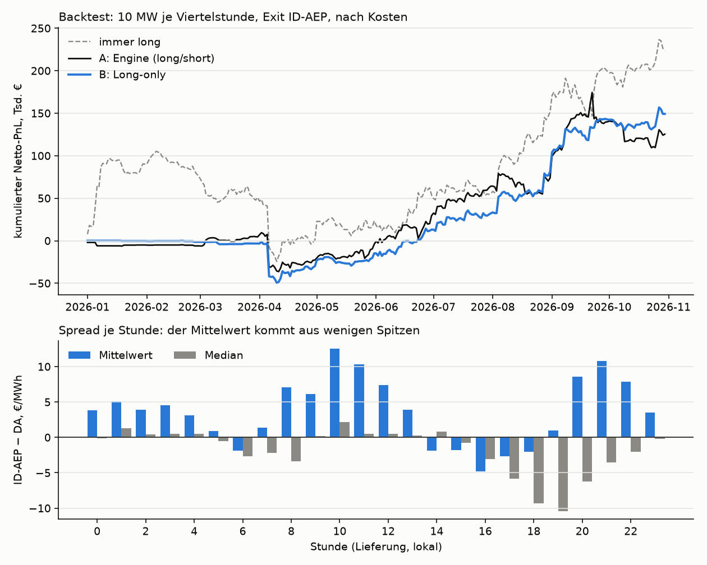

# Backtest-Report: B (Long-only)

Testzeitraum 2026-01-01 bis 2026-10-30 (303 Tage), Walk-Forward des Engines, 10 MW je Viertelstunde, Kosten 1,5 €/MWh Round Trip, Exit ID-AEP. Stand 2026-11-01.

| | **B: Long-only** | A: Engine | immer long |
|---|---:|---:|---:|
| Netto-PnL € | +149 219 | +125 345 | +223 555 |
| Volumen MWh | 26 848 | 41 135 | 72 720 |
| €/MWh | +5,56 | +3,05 | +3,07 |
| Sharpe p. a. (täglich) | 2,28 | 1,61 | 2,09 |
| t (HAC, täglich) | 1,97 | 1,49 | 1,60 |
| Max. Drawdown € | -49 341 | -64 957 | -129 624 |
| Schlechtester Tag € | -38 857 | -38 827 | -48 138 |
| Break-even-Slippage €/MWh | 6,6 | 4,0 | 4,1 |
| Spread gekappt ±200 €/MWh: PnL € (t) | +84 750 (2,20) | +127 421 (2,79) | +34 316 (0,37) |
| Spread gekappt ±100 €/MWh: PnL € (t) | +39 752 (1,19) | +94 776 (2,45) | -54 402 (-0,68) |
| ohne die 10 besten Tage € | +2 804 | -27 787 | +483 |
| die 10 besten Viertelstunden € | +60 844 | +60 844 | +77 833 |
| Sharpe 1. / 2. Hälfte | -0,53 / 4,49 | -0,14 / 2,77 | 0,44 / 3,70 |
| Monate im Plus | 6 von 10 | 6 von 10 | 7 von 10 |

- **Zerlegung:** A = B + A's Shorts. Die Shorts allein: -23 874 € auf 14 288 MWh (t -0,45).
- **B gegen A:** +79 €/Tag; bei gleichem Risiko t = 0,91; Sharpe-Differenz +0,67, Block-Bootstrap P(Sharpe B > A) = 0,79, 90-%-Intervall [-0,66; 2,20].
- **B gegen A, Spread gekappt ±200 €/MWh:** bei gleichem Risiko t = -0,96, P(Sharpe B > A) = 0,16.
- **B gegen immer long:** bei gleichem Risiko t = 0,19; P(Sharpe B > immer long) = 0,64, 90-%-Intervall [-1,17; 1,73].

**Lesart**

- Ungekappt hat B die höhere Sharpe (2,28 gegen 1,61), mit gekapptem Spread A (3,01 gegen 2,19). B gewinnt also über die Spike-Flanke, A über die normalen Viertelstunden. Welche Sicht gilt, hängt davon ab, ob die Spike-Preise des ID-AEP tatsächlich erzielbar sind.
- Konzentration: Ohne seine 10 besten Tage bleiben von B +2 804 € (2 % des Gewinns). Das Profil ist rechtsschief: viele kleine Verlusttage, wenige große Gewinntage.
- Die unbedingte Long-Prämie (immer long: Sharpe 2,09, gekappt ±200: +34 316 €) ist fast vollständig Spike-Prämie. B filtert sie mit den Prognosen des Engines: gekappt ±200 bleibt B bei +84 750 €.



**Robustheit von B**

| Variante | PnL € | Sharpe | t | t gekappt ±200 |
|---|---:|---:|---:|---:|
| feste Schwelle 2 €/MWh | +143 292 | 1,99 | 1,69 | 1,82 |
| feste Schwelle 5 €/MWh | +125 398 | 2,00 | 1,74 | 1,90 |
| feste Schwelle 10 €/MWh | +119 406 | 2,45 | 2,19 | 2,65 |
| B, Seeds 5–9 | +124 512 | 1,94 | 1,70 | 2,08 |
| A, Seeds 5–9 | +126 394 | 1,65 | 1,53 | 3,37 |

<sub>Engine 74ec0b4, Dataset-Revision b173afa, Code f7a76ba. Alle Zahlen in [reports/REPORT.md](reports/REPORT.md) und `reports/backtest.json`.</sub>

## Monate

| Monat | B € | A € | immer long € | Schwelle des Engines €/MWh |
|---|---:|---:|---:|---:|
| 2026-01 | -267 | -4 985 | +90 106 | 30 |
| 2026-02 | -1 051 | -1 051 | -13 658 | 30 |
| 2026-03 | -1 946 | +10 586 | -25 538 | 20 |
| 2026-04 | -26 622 | -27 226 | -49 881 | 5 |
| 2026-05 | +15 100 | +18 559 | +22 249 | 10 |
| 2026-06 | +27 986 | +33 691 | +30 469 | 5 |
| 2026-07 | +19 081 | +34 647 | +1 952 | 2 |
| 2026-08 | +48 708 | +9 647 | +95 796 | 2 |
| 2026-09 | +61 582 | +65 951 | +47 698 | 2 |
| 2026-10 | +6 647 | -14 474 | +24 363 | 2 |

## Der Spread

Alle 37 924 Viertelstunden von 2025-10-01 bis 2026-10-31:

| ID-AEP − DA | €/MWh |
|---|---:|
| Mittelwert | +3,61 |
| **Median** | **-1,12** |
| Mittelwert ohne die äußersten 5 % je Seite | -0,17 |
| Mittelwert der Viertelstunden mit \|Spread\| ≤ 100 €/MWh | -1,09 |
| Anteil Viertelstunden mit ID-AEP > DA | 48 % |
| Anteil des obersten 1 % an der Summe aller Spreads | **129 %** |

Spikes über +200 €/MWh: 301 Viertelstunden an 98 Tagen; unter −200 €/MWh: 69. Sie häufen sich in den Rampenstunden (Grafik unten).

| Stunde | Mittelwert | Median | Spikes > +200 | Spikes < −200 |
|---:|---:|---:|---:|---:|
| 0 | +3,8 | -0,1 | 2 | 0 |
| 1 | +5,1 | +1,3 | 3 | 0 |
| 2 | +3,9 | +0,4 | 3 | 0 |
| 3 | +4,5 | +0,5 | 2 | 0 |
| 4 | +3,1 | +0,5 | 0 | 0 |
| 5 | +0,9 | -0,5 | 0 | 0 |
| 6 | -1,9 | -2,7 | 1 | 0 |
| 7 | +1,4 | -2,2 | 11 | 2 |
| 8 | +7,1 | -3,4 | 19 | 1 |
| 9 | +6,1 | +0,2 | 13 | 0 |
| 10 | +12,5 | +2,2 | 27 | 0 |
| 11 | +10,3 | +0,5 | 15 | 3 |
| 12 | +7,4 | +0,5 | 14 | 3 |
| 13 | +3,9 | +0,3 | 7 | 5 |
| 14 | -1,9 | +0,8 | 5 | 4 |
| 15 | -1,8 | -0,8 | 4 | 4 |
| 16 | -4,8 | -3,1 | 4 | 2 |
| 17 | -2,7 | -5,8 | 19 | 3 |
| 18 | -2,0 | -9,3 | 18 | 4 |
| 19 | +1,0 | -10,4 | 38 | 20 |
| 20 | +8,6 | -6,2 | 35 | 8 |
| 21 | +10,8 | -3,5 | 39 | 7 |
| 22 | +7,9 | -2,0 | 15 | 3 |
| 23 | +3,5 | -0,2 | 7 | 0 |

## Alle Kennzahlen je Bein

```json
{
 "B": {
  "days": 303,
  "days_traded": 232,
  "quarter_hours_traded": 10739,
  "mwh": 26847.5,
  "net_eur": 149219.0,
  "gross_eur": 189490.0,
  "costs_eur": 40271.0,
  "eur_per_mwh": 5.56,
  "hit_rate": 0.462,
  "sharpe_daily_ann": 2.28,
  "t_daily_hac": 1.97,
  "max_drawdown_eur": -49341.0,
  "worst_day_eur": -38857.0,
  "best_day_eur": 22940.0,
  "missing_exit_qh": 0,
  "missing_da_qh": 0,
  "without_best_days_eur": 2804.0,
  "top_qh_net_eur": 60844.0,
  "break_even_slippage_eur_mwh": 6.56,
  "sharpe_first_half": -0.53,
  "sharpe_second_half": 4.49,
  "positive_months": 6,
  "months": 10
 },
 "A": {
  "days": 303,
  "days_traded": 260,
  "quarter_hours_traded": 16454,
  "mwh": 41135.0,
  "net_eur": 125345.0,
  "gross_eur": 187048.0,
  "costs_eur": 61702.0,
  "eur_per_mwh": 3.05,
  "hit_rate": 0.499,
  "sharpe_daily_ann": 1.61,
  "t_daily_hac": 1.49,
  "max_drawdown_eur": -64957.0,
  "worst_day_eur": -38827.0,
  "best_day_eur": 25336.0,
  "missing_exit_qh": 0,
  "missing_da_qh": 0,
  "without_best_days_eur": -27787.0,
  "top_qh_net_eur": 60844.0,
  "break_even_slippage_eur_mwh": 4.05,
  "sharpe_first_half": -0.14,
  "sharpe_second_half": 2.77,
  "positive_months": 6,
  "months": 10
 },
 "A_short": {
  "days": 303,
  "days_traded": 232,
  "quarter_hours_traded": 5715,
  "mwh": 14287.5,
  "net_eur": -23874.0,
  "gross_eur": -2442.0,
  "costs_eur": 21431.0,
  "eur_per_mwh": -1.67,
  "hit_rate": 0.569,
  "sharpe_daily_ann": -0.51,
  "t_daily_hac": -0.45,
  "max_drawdown_eur": -68235.0,
  "worst_day_eur": -31085.0,
  "best_day_eur": 14239.0,
  "missing_exit_qh": 0,
  "missing_da_qh": 0,
  "without_best_days_eur": -85850.0,
  "top_qh_net_eur": 10182.0,
  "break_even_slippage_eur_mwh": -0.67,
  "sharpe_first_half": 0.97,
  "sharpe_second_half": -1.1,
  "positive_months": 5,
  "months": 10
 },
 "always_long": {
  "days": 303,
  "days_traded": 303,
  "quarter_hours_traded": 29088,
  "mwh": 72720.0,
  "net_eur": 223555.0,
  "gross_eur": 332635.0,
  "costs_eur": 109080.0,
  "eur_per_mwh": 3.07,
  "hit_rate": 0.445,
  "sharpe_daily_ann": 2.09,
  "t_daily_hac": 1.6,
  "max_drawdown_eur": -129624.0,
  "worst_day_eur": -48138.0,
  "best_day_eur": 30229.0,
  "missing_exit_qh": 0,
  "missing_da_qh": 0,
  "without_best_days_eur": 483.0,
  "top_qh_net_eur": 77833.0,
  "break_even_slippage_eur_mwh": 4.07,
  "sharpe_first_half": 0.44,
  "sharpe_second_half": 3.7,
  "positive_months": 7,
  "months": 10
 }
}
```
