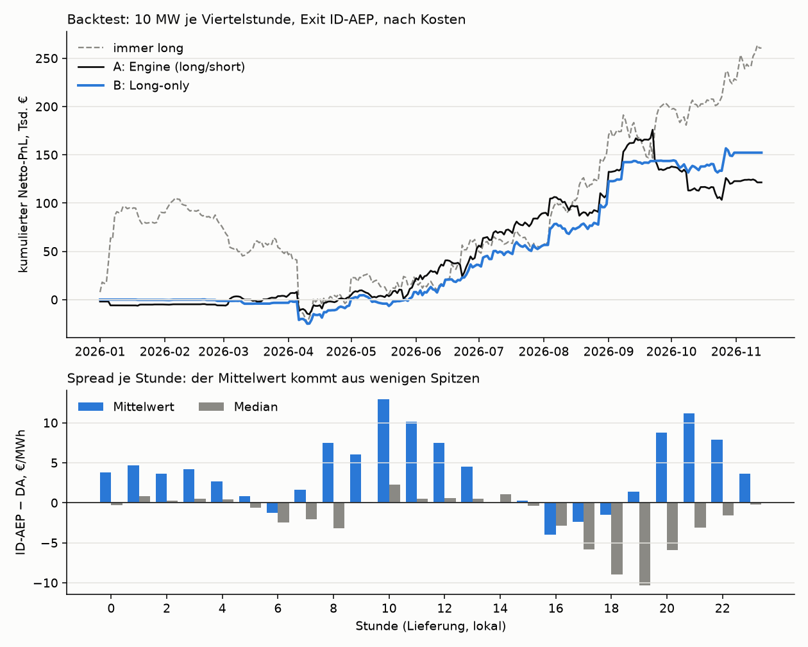

# Backtest-Report: B (Long-only)

Testzeitraum 2026-01-01 bis 2026-11-13 (317 Tage), Walk-Forward des Engines, 10 MW je Viertelstunde, Kosten 1,5 €/MWh Round Trip, Exit ID-AEP. Stand 2026-11-15.

| | **B: Long-only** | A: Engine | immer long |
|---|---:|---:|---:|
| Netto-PnL € | +152 236 | +121 450 | +260 590 |
| Volumen MWh | 23 198 | 34 715 | 76 080 |
| €/MWh | +6,56 | +3,50 | +3,43 |
| Sharpe p. a. (täglich) | 2,79 | 1,77 | 2,33 |
| t (HAC, täglich) | 2,58 | 1,61 | 1,85 |
| Max. Drawdown € | -25 064 | -72 617 | -129 624 |
| Schlechtester Tag € | -19 759 | -30 602 | -48 138 |
| Break-even-Slippage €/MWh | 7,6 | 4,5 | 4,4 |
| Spread gekappt ±200 €/MWh: PnL € (t) | +86 807 (2,61) | +119 939 (2,85) | +66 250 (0,70) |
| Spread gekappt ±100 €/MWh: PnL € (t) | +49 749 (1,68) | +95 250 (2,63) | -32 620 (-0,40) |
| ohne die 10 besten Tage € | +16 586 | -15 232 | +37 519 |
| die 10 besten Viertelstunden € | +60 622 | +60 622 | +77 833 |
| Sharpe 1. / 2. Hälfte | 0,59 / 4,18 | 1,39 / 2,12 | 0,31 / 4,26 |
| Monate im Plus | 6 von 11 | 6 von 11 | 8 von 11 |

- **Zerlegung:** A = B + A's Shorts. Die Shorts allein: -30 786 € auf 11 518 MWh (t -0,63).
- **B gegen A:** +97 €/Tag; bei gleichem Risiko t = 1,36; Sharpe-Differenz +1,02, Block-Bootstrap P(Sharpe B > A) = 0,85, 90-%-Intervall [-0,49; 2,49].
- **B gegen A, Spread gekappt ±200 €/MWh:** bei gleichem Risiko t = -0,83, P(Sharpe B > A) = 0,20.
- **B gegen immer long:** bei gleichem Risiko t = 0,42; P(Sharpe B > immer long) = 0,69, 90-%-Intervall [-1,10; 1,94].

**Lesart**

- Ungekappt hat B die höhere Sharpe (2,79 gegen 1,77), mit gekapptem Spread A (3,06 gegen 2,46). B gewinnt also über die Spike-Flanke, A über die normalen Viertelstunden. Welche Sicht gilt, hängt davon ab, ob die Spike-Preise des ID-AEP tatsächlich erzielbar sind.
- Konzentration: Ohne seine 10 besten Tage bleiben von B +16 586 € (11 % des Gewinns). Das Profil ist rechtsschief: viele kleine Verlusttage, wenige große Gewinntage.
- Die unbedingte Long-Prämie (immer long: Sharpe 2,33, gekappt ±200: +66 250 €) ist fast vollständig Spike-Prämie. B filtert sie mit den Prognosen des Engines: gekappt ±200 bleibt B bei +86 807 €.



**Robustheit von B**

| Variante | PnL € | Sharpe | t | t gekappt ±200 |
|---|---:|---:|---:|---:|
| feste Schwelle 2 €/MWh | +154 758 | 2,08 | 1,80 | 2,10 |
| feste Schwelle 5 €/MWh | +145 660 | 2,22 | 1,95 | 2,21 |
| feste Schwelle 10 €/MWh | +129 208 | 2,71 | 2,47 | 2,79 |
| B, Seeds 5–9 | +137 126 | 2,00 | 1,77 | 2,18 |
| A, Seeds 5–9 | +129 288 | 1,61 | 1,47 | 3,01 |

<sub>Engine 74ec0b4, Dataset-Revision 9cef7d2, Code a399eba. Alle Zahlen in [reports/REPORT.md](reports/REPORT.md) und `reports/backtest.json`.</sub>

## Monate

| Monat | B € | A € | immer long € | Schwelle des Engines €/MWh |
|---|---:|---:|---:|---:|
| 2026-01 | -267 | -4 988 | +90 106 | 30 |
| 2026-02 | -970 | -970 | -13 658 | 30 |
| 2026-03 | -2 055 | +8 781 | -25 538 | 20 |
| 2026-04 | -2 958 | -178 | -49 881 | 10 |
| 2026-05 | +14 098 | +15 152 | +22 249 | 10 |
| 2026-06 | +28 327 | +35 062 | +30 469 | 2 |
| 2026-07 | +19 331 | +36 212 | +1 952 | 2 |
| 2026-08 | +43 330 | +19 435 | +95 796 | 5 |
| 2026-09 | +44 767 | +28 018 | +47 698 | 15 |
| 2026-10 | +8 632 | -13 780 | +29 425 | 2 |
| 2026-11 | +0 | -1 296 | +31 974 | 30 |

## Der Spread

Alle 39 268 Viertelstunden von 2025-10-01 bis 2026-11-14:

| ID-AEP − DA | €/MWh |
|---|---:|
| Mittelwert | +3,91 |
| **Median** | **-1,06** |
| Mittelwert ohne die äußersten 5 % je Seite | +0,07 |
| Mittelwert der Viertelstunden mit \|Spread\| ≤ 100 €/MWh | -0,94 |
| Anteil Viertelstunden mit ID-AEP > DA | 48 % |
| Anteil des obersten 1 % an der Summe aller Spreads | **118 %** |

Spikes über +200 €/MWh: 321 Viertelstunden an 103 Tagen; unter −200 €/MWh: 69. Sie häufen sich in den Rampenstunden (Grafik unten).

| Stunde | Mittelwert | Median | Spikes > +200 | Spikes < −200 |
|---:|---:|---:|---:|---:|
| 0 | +3,8 | -0,3 | 2 | 0 |
| 1 | +4,7 | +0,8 | 3 | 0 |
| 2 | +3,6 | +0,3 | 3 | 0 |
| 3 | +4,2 | +0,5 | 2 | 0 |
| 4 | +2,7 | +0,4 | 0 | 0 |
| 5 | +0,8 | -0,6 | 0 | 0 |
| 6 | -1,3 | -2,5 | 1 | 0 |
| 7 | +1,6 | -2,1 | 11 | 2 |
| 8 | +7,5 | -3,2 | 21 | 1 |
| 9 | +6,0 | +0,1 | 14 | 0 |
| 10 | +12,9 | +2,3 | 28 | 0 |
| 11 | +10,1 | +0,5 | 15 | 3 |
| 12 | +7,5 | +0,6 | 14 | 3 |
| 13 | +4,5 | +0,5 | 8 | 5 |
| 14 | -0,0 | +1,1 | 9 | 4 |
| 15 | +0,3 | -0,4 | 8 | 4 |
| 16 | -4,0 | -2,9 | 5 | 2 |
| 17 | -2,4 | -5,8 | 21 | 3 |
| 18 | -1,5 | -9,0 | 18 | 4 |
| 19 | +1,4 | -10,3 | 40 | 20 |
| 20 | +8,8 | -5,9 | 36 | 8 |
| 21 | +11,2 | -3,1 | 40 | 7 |
| 22 | +7,9 | -1,6 | 15 | 3 |
| 23 | +3,6 | -0,2 | 7 | 0 |

## Alle Kennzahlen je Bein

```json
{
 "B": {
  "days": 317,
  "days_traded": 223,
  "quarter_hours_traded": 9279,
  "mwh": 23197.5,
  "net_eur": 152236.0,
  "gross_eur": 187032.0,
  "costs_eur": 34796.0,
  "eur_per_mwh": 6.56,
  "hit_rate": 0.471,
  "sharpe_daily_ann": 2.79,
  "t_daily_hac": 2.58,
  "max_drawdown_eur": -25064.0,
  "worst_day_eur": -19759.0,
  "best_day_eur": 23894.0,
  "missing_exit_qh": 0,
  "missing_da_qh": 0,
  "without_best_days_eur": 16586.0,
  "top_qh_net_eur": 60622.0,
  "break_even_slippage_eur_mwh": 7.56,
  "sharpe_first_half": 0.59,
  "sharpe_second_half": 4.18,
  "positive_months": 6,
  "months": 11
 },
 "A": {
  "days": 317,
  "days_traded": 268,
  "quarter_hours_traded": 13886,
  "mwh": 34715.0,
  "net_eur": 121450.0,
  "gross_eur": 173522.0,
  "costs_eur": 52072.0,
  "eur_per_mwh": 3.5,
  "hit_rate": 0.503,
  "sharpe_daily_ann": 1.77,
  "t_daily_hac": 1.61,
  "max_drawdown_eur": -72617.0,
  "worst_day_eur": -30602.0,
  "best_day_eur": 23894.0,
  "missing_exit_qh": 0,
  "missing_da_qh": 0,
  "without_best_days_eur": -15232.0,
  "top_qh_net_eur": 60622.0,
  "break_even_slippage_eur_mwh": 4.5,
  "sharpe_first_half": 1.39,
  "sharpe_second_half": 2.12,
  "positive_months": 6,
  "months": 11
 },
 "A_short": {
  "days": 317,
  "days_traded": 226,
  "quarter_hours_traded": 4607,
  "mwh": 11517.5,
  "net_eur": -30786.0,
  "gross_eur": -13510.0,
  "costs_eur": 17276.0,
  "eur_per_mwh": -2.67,
  "hit_rate": 0.568,
  "sharpe_daily_ann": -0.69,
  "t_daily_hac": -0.63,
  "max_drawdown_eur": -64494.0,
  "worst_day_eur": -30602.0,
  "best_day_eur": 8566.0,
  "missing_exit_qh": 0,
  "missing_da_qh": 0,
  "without_best_days_eur": -81306.0,
  "top_qh_net_eur": 10182.0,
  "break_even_slippage_eur_mwh": -1.67,
  "sharpe_first_half": 1.53,
  "sharpe_second_half": -1.62,
  "positive_months": 5,
  "months": 11
 },
 "always_long": {
  "days": 317,
  "days_traded": 317,
  "quarter_hours_traded": 30432,
  "mwh": 76080.0,
  "net_eur": 260590.0,
  "gross_eur": 374710.0,
  "costs_eur": 114120.0,
  "eur_per_mwh": 3.43,
  "hit_rate": 0.448,
  "sharpe_daily_ann": 2.33,
  "t_daily_hac": 1.85,
  "max_drawdown_eur": -129624.0,
  "worst_day_eur": -48138.0,
  "best_day_eur": 30229.0,
  "missing_exit_qh": 0,
  "missing_da_qh": 0,
  "without_best_days_eur": 37519.0,
  "top_qh_net_eur": 77833.0,
  "break_even_slippage_eur_mwh": 4.43,
  "sharpe_first_half": 0.31,
  "sharpe_second_half": 4.26,
  "positive_months": 8,
  "months": 11
 }
}
```
